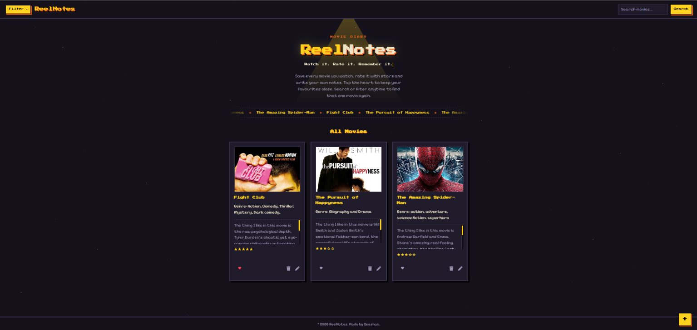
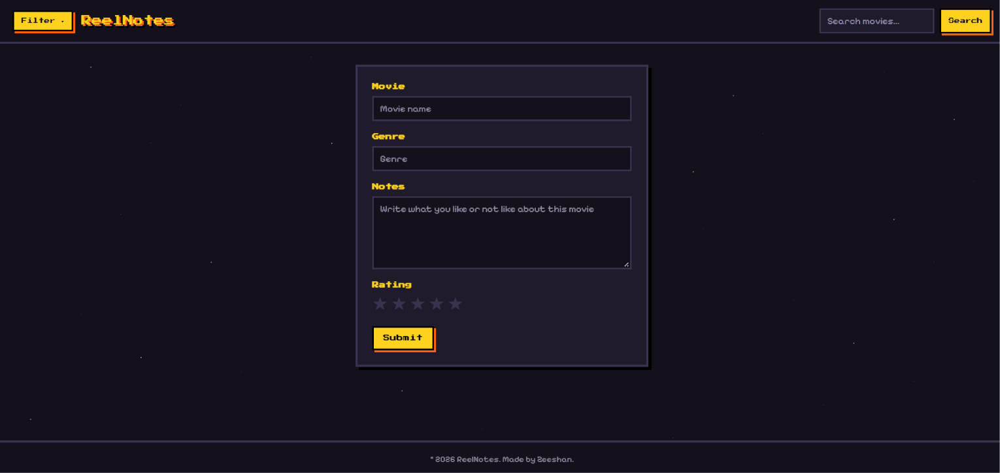
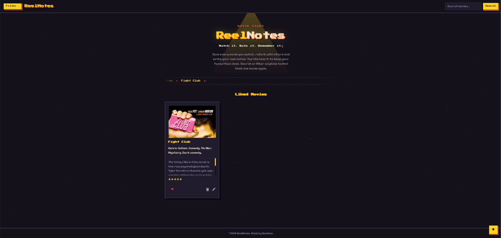

# ReelNotes

Watch it. Rate it. Remember it.

ReelNotes is a movie diary web app. Save every movie you watch, rate it with stars, write your own notes, and mark your favourites. Poster images are fetched automatically from the OMDb API.

## Features

- **Add a new movie:** Click the **+** button to open the new movie page. Enter the movie name, genre, your notes and a rating, then submit. The poster is fetched automatically from OMDb.
- **Go back to Home:** Click the **ReelNotes logo** at any time to return to the home page.
- **Search:** Type a movie name in the search bar at the top right and click **Search** to see matching movies.
- **Filter:** Use the **Filter** button at the top left to filter your movies.
- **Edit:** Click the pencil icon on a movie card to update its details.
- **Delete:** Click the trash icon on a movie card to remove it.
- **Favourites:** Click the heart icon on a card to mark a movie as a favourite.
- **Ratings and notes:** Each card shows the genre, your notes and your star rating.

## Tech Stack

- Node.js
- Express.js
- EJS (templating)
- PostgreSQL
- Axios
- OMDb API
- HTML, CSS

## Screenshots

### Home

### Add New Movie

### Favourites
